# jff

A minimal stacking Wayland compositor, just for fun. Written in Rust, built on
[Smithay](https://github.com/Smithay/smithay). GPL-3.0-or-later.

## What it does

- Stacking windows, click-to-focus, Alt+drag to move or resize anything.
- Workspaces (nine by default), shared across every monitor.
- Maximize and fullscreen, both client-requested and via bindings.
- An overview: every window of the current monitor as a thumbnail. Drag one to
  another monitor to move it there.
- Screenshots: full monitor, single window, or a dragged rectangle. PNG,
  optionally to the clipboard.
- X11 apps through `xwayland-satellite`.
- Portals, with a `jff-portals.conf` written on first start.
- A control socket: `jff msg <command>`, and `watch` that streams every change
  as one line of JSON.
- Gaming plumbing: explicit sync, adaptive sync, `wp_content_type_v1`, direct
  scanout, tearing hints, fifo and commit-timing, pointer constraints.

## What it doesn't do

Tiling, animations, blur, rounded corners, per-window rules, a settings GUI, a
bar, a launcher, notifications, a lock screen.

## Install

Requires a recent Rust toolchain, seatd or logind, and the usual libinput / DRM /
GBM development files.

    git clone https://github.com/you/jff
    cd jff
    cargo build --release
    sudo install -Dm755 target/release/jff /usr/local/bin/jff

Run it from a TTY:

    jff

Or nested inside your current session:

    JFF_BACKEND=winit jff alacritty

Without `JFF_BACKEND`, jff picks winit when `WAYLAND_DISPLAY` or `DISPLAY` is
set, and TTY otherwise.

## Configure

Read from `$JFF_CONFIG`, then `$XDG_CONFIG_HOME/jff/config.kdl`, then
`~/.config/jff/config.kdl`. Missing file, small built-in defaults.

    workspaces 9
    maximize-new-windows true
    drag-modifier "Alt"

    binds {
        Alt+Return { terminal; }
        Alt+D { spawn "fuzzel"; }
        Alt+O { overview; }
        Alt+M { maximize; }
        Super+F { fullscreen; }
        Alt+Q { close; }
        Print { screenshot-area; }
        Alt+Shift+R { reload-config; }
        Ctrl+Alt+BackSpace { quit; }
    }

    keyboard {
        xkb { layout "us"; options "caps:escape"; }
        repeat-delay 300
        repeat-rate 40
    }

    outputs {
        output "DP-1" {
            position 0 0
            mode "2560x1440@144"
            adaptive-sync "fullscreen"
        }
    }

Every setting the config understands is documented in the module header of
`src/config/mod.rs`. That file is the spec.

Reload with `Alt+Shift+R` after editing.

## Control socket

    jff msg views            every window, as JSON
    jff msg focused          the window with the keyboard
    jff msg workspace 2      show workspace 2
    jff msg focus 7          raise window 7 and focus it
    jff msg spawn "firefox"  start in jff's environment
    jff msg watch outputs    stream monitor changes, one line each

`watch` sends a `snapshot` first, then one event per line: `view-opened`,
`title`, `geometry`, `focus`, … The wire format is in the header of
`src/ipc/mod.rs`.

## Source layout

- `primitives/` pure geometry, unit-tested
- `desk/` the stacking model, also pure and unit-tested
- `config/` the KDL parser, defaults, and round-trip
- `input/` key and pointer pipeline, and jff's own grabs
- `protocol/` one file per Wayland protocol family
- `feature/` overview, screenshots, workspaces, xwayland, portals, ICC
- `ipc/` the control socket and its events
- `render/` cursor, render elements, fast/animations split
- `app/` startup, winit backend, TTY backend
- `state/` `JffState` and the protocol handlers that hang off it

## Status

Early. The core works, the surface is small on purpose, and the protocol list
grows one file at a time.

## License

GPL-3.0-or-later. See [LICENSE](LICENSE).
