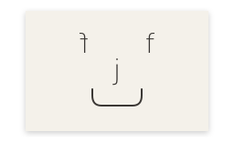

# jff

<table>
  <tr>
    <td></td>
    <td align="center">
      A hybrid tiling-and-stacking Wayland compositor that started as
      "just for fun" and kept growing.
    </td>
  </tr>
</table>

<https://github.com/user-attachments/assets/cf061a7a-07f5-4545-918a-3840cadb2f52>

## What it does

- **Windows:** stacking, click-to-focus, Alt+drag to move or resize anything,
  maximize, fullscreen, snap to a half of the monitor, minimize, a scratchpad,
  and an Alt+Tab switcher.
- **Tiling when you want it:** windows float by default. Turn on
  `tiling-containers` and any group of windows can tile among themselves, with
  splits you drag, names you give them, and layouts you save and bring back.
  Everything else stays floating, so you never have to pick a side.
- **Workspaces:** nine by default, shared across monitors, or one set per
  monitor.
- **Overview:** every window of the current monitor as a thumbnail, with a
  built-in app launcher search. Drag a window to another monitor or workspace.
- **Window rules:** decide what an app does the moment it opens. Send it to a
  monitor or a workspace, maximize it, float it, give it a size, drop it in the
  middle of the screen or at an exact spot, make it a little see-through, put it
  in a named container, or set how bright its whites are on an HDR monitor. Match
  by app id, title, tag or dialog, and the first rule that fits wins.
- **Touchscreens and gestures:** fingers reach apps as real touch, and three
  fingers belong to jff: swipe sideways to change workspace, up to open the
  overview, down to close it, just like on a touchpad. Pick which monitor each
  touchscreen covers, rotated and scaled screens line up on their own, and apps
  that have never heard of touch still get your taps as clicks. Pens and
  graphics tablets work too.
- **Multi-monitor:** positions, modes, hotplug, rotation, scaling, adaptive sync,
  HDR, and an ICC calibration profile per monitor. Works with wlr-randr and
  kanshi.
- **Screenshots:** full monitor, single window, or a dragged rectangle, saved
  as PNG and optionally copied to the clipboard.
- **Looks:** gaps, rounded corners, focus borders, open/close animations, and
  background blur for translucent windows and panels (off until you enable it,
  and it needs a wallpaper set).
- **Hot corner** that opens the overview.
- **Scriptable:** `jff msg` talks to the running compositor (list monitors, start
  programs, click, switch layouts), and an event stream tells your scripts what
  jff is doing.
- **X11 apps** (Steam, Wine, older games and tools): jff has no X server of its
  own. Install [`xwayland-satellite`](https://github.com/Supreeeme/xwayland-satellite)
  (it needs `Xwayland` too) and jff starts it for you and sets `DISPLAY` for
  everything it launches. Without it, X11 apps simply don't run.
- **Portals** (file dialogs and friends) are set up on first start.
- **Remembers windows:** apps that support `xdg-session-management` get their
  windows put back where they were.
- **Works with your tools:** bars (waybar, yambar, nwg-panel), launchers,
  notification daemons, lockers (swaylock, hyprlock), idle daemons (swayidle),
  input methods (fcitx5, ibus), screen recorders and sharers (OBS, wayvnc,
  grim), `wtype` and `wlrctl`, graphics tablets.
- **Sandboxed apps** (Flatpak) don't get access to the clipboard managers,
  virtual keyboard or pointer.

## Colour and HDR

jff takes colour seriously. Switch on `hdr` for a monitor and jff drives it in
HDR, with the desktop at a white level you choose (`sdr-white`) and everything
else mapped to what the screen can really show.

- **HDR and normal windows side by side.** Ordinary apps are shown as sRGB at
  your desktop brightness. HDR apps keep their extra light, tone-mapped to the
  monitor.
- **Per-app brightness.** A window rule can give a game or a video player its
  own SDR white, brighter or dimmer than the desktop, or force a window to be
  read as plain sRGB whatever it claims.
- **Apps tell jff the truth.** The colour-management protocol lets players and
  games say exactly what colour space and brightness they use, and jff shows it
  right instead of guessing.
- **Wide gamut and calibration.** An ICC profile per monitor, and gamut mapping
  for screens that are wider (or narrower) than sRGB.
- **HDR you can keep.** Screenshots of HDR content can stay HDR instead of being
  squashed to SDR.

## Made for games and speed

jff keeps the path from your game to the screen short, and implements the
protocols games and video players rely on.

By default jff renders on a fast path: every frame goes straight to the primary
plane, with no blur, fades or slides in the way. Blur and animations switch to a
separate path only when you turn them on.

| Protocol                                         | What it does for you                                                                                                                  |
| ------------------------------------------------ | ------------------------------------------------------------------------------------------------------------------------------------- |
| Explicit sync (`linux-drm-syncobj`)              | No implicit-sync stalls, fixes flicker and stutter with modern GPU drivers                                                            |
| `linux-dmabuf` with feedback                     | Clients allocate buffers the GPU and display can use directly, which makes direct scanout possible                                    |
| Direct scanout                                   | A fullscreen game goes to the monitor without being composited                                                                        |
| Adaptive sync (`off`, `fullscreen`, `always`)    | VRR per monitor                                                                                                                       |
| `wp_tearing_control`                             | Games can ask for tearing and cut input lag (`allow-tearing`, async page flips)                                                       |
| `wp_content_type`                                | A fullscreen game makes the monitor switch to its game mode (`content-type-hint`)                                                     |
| `wp_presentation`                                | Games and players learn when frames really hit the screen, for pacing and A/V sync                                                    |
| `wp_fifo` and `wp_commit_timing`                 | Frame pacing without busy waiting                                                                                                     |
| `wp_fractional_scale` and `wp_viewporter`        | Sharp rendering at any scale, and cheap scaling of video and game output                                                              |
| `wp_single_pixel_buffer` and `wp_alpha_modifier` | Solid colours and fades without allocating buffers                                                                                    |
| Pointer constraints and relative pointer         | Mouse lock and raw mouse motion for first-person games                                                                                |
| `wp_pointer_warp`                                | Apps can move the pointer inside their own window                                                                                     |
| `wp_cursor_shape`                                | The compositor draws the cursor, no per-app cursor buffers                                                                            |
| Keyboard shortcuts inhibit                       | A game can take every key. `Super+Escape` always gives them back                                                                      |
| Idle inhibit                                     | Screen stays awake during games and video                                                                                             |
| DRM lease                                        | VR headsets are handed straight to the VR runtime                                                                                     |
| `wp_color_management`                            | HDR and wide-gamut games and video are shown in their own colours and brightness, not flattened to sRGB                               |
| `wp_color_representation`                        | Video is drawn with the colour matrix and range it declares (`color-representation { yuv }`), but such a surface skips direct scanout |

## Build

Requires a recent Rust toolchain, seatd or logind, and the usual libinput / DRM /
GBM development files. jff uses a Smithay branch from git, so the first build
needs network access.

    git clone https://github.com/JFF-WM/jff
    cd jff
    cargo build --release

Needed for a complete desktop:

- `xwayland-satellite` and `Xwayland`, for X11 apps (see above). jff starts the
  satellite itself when it's installed.
- `xdg-desktop-portal-gtk`, for file dialogs.
- fontconfig (`fc-match`), for the toasts and overview text.
- A wallpaper tool such as `swaybg` or `wbg`, needed for blur.

## Run it

From a TTY:

    jff

Nested inside your current session:

    JFF_BACKEND=winit jff alacritty

Without `JFF_BACKEND`, jff picks winit when `WAYLAND_DISPLAY` or `DISPLAY` is
set, and TTY otherwise.

Logging uses `RUST_LOG` (default `info`).

## Install as a session

To have jff show up in the session list of your login manager (GDM, SDDM, Ly,
greetd, …):

    sudo make install

This installs the binary, the `jff-session` wrapper, and the `.desktop` file
under `/usr/share/wayland-sessions/` so the login manager picks it up. Override
the prefix with `make install PREFIX=/opt/jff`. To remove it:

    sudo make uninstall

## Configure

jff works with no config file. To change anything, copy
[`config.example`](config.example) to `~/.config/jff/config.kdl` and edit it
(or point `$JFF_CONFIG` at it). It is commented, and every block is optional.

jff watches the file and reloads it when it changes. To check a file without
starting anything:

    jff check-config [FILE]

It reports errors, and warns about settings jff doesn't know.

## License

GPL-3.0-or-later. See [LICENSE](LICENSE).
